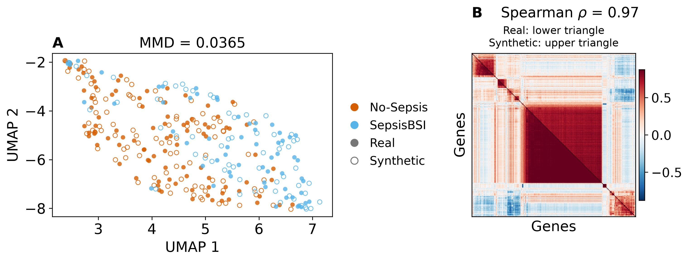
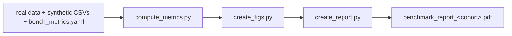

# rna-twin

Three synthetic bulk RNA-seq cohorts, publicly released with the evidence needed to judge them.

[](https://www.python.org/)
[](LICENSE)
[](hf/LICENSE)
<!-- TODO: link the companion preprint DOI once it is assigned. -->

[](https://huggingface.co/datasets/NandaAditya/rna-twin)

We generated synthetic versions of three public cohorts with dbTwin: pediatric inflammatory
bowel disease (RISK), sepsis, and lung adenocarcinoma (TCGA-LUAD). A synthetic cohort can match
real expression distributions and still give different answers, so the benchmark tests the
answers directly. For each cohort, it compares synthetic and real data on gene co-expression,
differential expression, classifiers scored on held-out real patients, and the genes those
classifiers rely on (SHAP). It also runs two empirical privacy attacks and writes everything to
a PDF report.

This repository holds the benchmark code, the real cohorts, and the saved results. The
synthetic cohorts are on [Hugging Face](https://huggingface.co/datasets/NandaAditya/rna-twin),
available to anyone who accepts a short data use agreement.



*Sepsis cohort. (A) Real and synthetic samples embedded in a single UMAP fit. (B) Correlations
among the 500 most variable genes, real below the diagonal and synthetic above, in the same gene
order.*

## Quick start

1. Install [uv](https://docs.astral.sh/uv/getting-started/installation/), then clone the
   repository:

   ```sh
   git clone https://github.com/Nanda-Aditya/rna-twin.git
   cd rna-twin
   ```

2. Download the synthetic data and run the benchmark on one cohort:

   ```sh
   uv run python get_data.py
   uv run python scripts/run_pipe.py sepsis
   ```

   `get_data.py` sets up both Python environments and asks you to log in to Hugging Face. If you
   have not yet accepted the data use agreement, it opens the
   [dataset page](https://huggingface.co/datasets/NandaAditya/rna-twin) and waits while you do.

The full run recomputes every metric from the real and synthetic CSVs and takes 1 to 2 hours per
cohort. To rebuild only the figures and the PDF from the saved metrics, add `--no-full-compute`;
this takes under a minute.

The report is written to `datasets/sepsis/dbTwin/benchmark_report_sepsis.pdf`. In the same
folder, `artifacts/figs/` holds the figures and `artifacts/metrics.csv` the summary metrics.

## Results

All numbers below come from the reports in this repository, generated on November 2 and 3, 2026.
Co-expression, UMAP, and DE compare the full synthetic cohort with the full real cohort once.
Values with ± are the mean ± SD over five outer splits. ✅ marks a pass against the report's
fixed thresholds (see [How we evaluate](#how-we-evaluate)).

| | Pass if | [Pediatric RISK](datasets/pediatric_risk/dbTwin/benchmark_report_pediatric_risk.pdf) | [Sepsis](datasets/sepsis/dbTwin/benchmark_report_sepsis.pdf) | [TCGA-LUAD](datasets/tcga_luad/dbTwin/benchmark_report_tcga_luad.pdf) |
|---|---|---:|---:|---:|
| Co-expression Spearman ρ | ≥ 0.8 | 0.996 ✅ | 0.965 ✅ | 0.940 ✅ |
| UMAP MMD | ≤ 0.1 | 0.022 ✅ | 0.037 ✅ | 0.020 ✅ |
| ROC-AUC, real-trained (TRTR) | reference | 0.880 ± 0.032 | 0.894 ± 0.032 | 0.573 ± 0.036 |
| ROC-AUC, synthetic-trained (TSTR) | ≥ TRTR − 0.05 | 0.878 ± 0.035 ✅ | 0.893 ± 0.027 ✅ | 0.573 ± 0.044 ✅ |
| SHAP Pearson r | ≥ 0.8 | 0.949 ± 0.012 ✅ | 0.881 ± 0.043 ✅ | 0.828 ± 0.056 ✅ |

TRTR models are trained on real data and TSTR models on synthetic data. Both are tested on the
same held-out real patients, whom the generator never saw. Synthetic-trained classifiers matched
real-trained ones in all three cohorts and relied on the same genes. Tumour stage in TCGA-LUAD is
hard to predict even from real data, and the synthetic cohort reproduced that ceiling rather
than inflating it.

**Differential expression.** DESeq2 runs separately on the full real and full synthetic cohorts.
Log2FC r and slope compare synthetic with real fold changes over all real DE genes; a slope below
1 means synthetic effects are shrunk toward zero. Recall is the share of real DE genes that are
also significant in the synthetic cohort at the relaxed rule.

| Cohort | Contrast | Real DE genes | log2FC r (≥ 0.8) | Slope | Recall (≥ 80%) |
|---|---|---:|---:|---:|---:|
| Pediatric RISK | Crohn's disease vs control | 5,641 | 0.993 ✅ | 1.00 | 96% ✅ |
| Pediatric RISK | Ulcerative colitis vs control | 1,169 | 0.980 ✅ | 0.95 | 82% ✅ |
| Sepsis | SepsisBSI vs No-Sepsis | 2,743 | 0.994 ✅ | 1.01 | 97% ✅ |
| TCGA-LUAD | KRAS, 0 vs 1 | 1,121 | 0.961 ✅ | 0.94 | 92% ✅ |
| TCGA-LUAD | EGFR, 0 vs 1 | 1,369 | 0.970 ✅ | 0.92 | 93% ✅ |
| TCGA-LUAD | STK11, 0 vs 1 (not an anchor column, not graded) | 2,586 | 0.883 | 0.70 | 69% |

Effect sizes kept their real magnitude in every anchored contrast (slope 0.92 to 1.01). STK11 is
the instructive exception, and the only contrast on a column not declared as an anchor column.
Its effect sizes still correlated with the real ones (r = 0.88) but shrank by about 30%, and
recall fell to 69%. This is how dbTwin is designed to behave: associations with anchor columns
are preserved with high fidelity, and associations with other columns only partially.

**Privacy.**

| | Pediatric RISK | Sepsis | TCGA-LUAD |
|---|---:|---:|---:|
| DCR 5th-percentile ratio | 0.916 ± 0.011 | 1.056 ± 0.035 | 1.047 ± 0.012 |
| Excess training success, attacker knows age and sex | 0.029 | 0.066 | 0.028 |
| Excess training success, attacker also knows 100 genes | 0.094 | 0.112 | 0.143 |
| Secrets with excess > 0.2 (age and sex / + 100 genes) | 0 / 1 | 0 / 0 | 0 / 3 |

DCR checks for memorization. A ratio near 1 means synthetic samples sit no closer to training
patients than training patients sit to each other. Attribute inference asks whether the
synthetic cohort helps an attacker learn something new about a real training patient. Excess
training success is the attack's success rate on training patients minus its rate on held-out
patients, and the two excess rows report the median of the 10 highest per-secret means. An
attacker who knows only age and sex gains little (0.028 to 0.066); one who also holds 100 genes
measured on the patient's own sample gains more (0.094 to 0.143). Neither test proves privacy.

## The cohorts

dbTwin (dbTwin, Inc.) is a proprietary ML-based generator for clinico-transcriptomic data. It
works directly on full-transcriptome expression and clinical metadata tables. It optionally
takes up to 8 anchor columns, the clinical or translational variables the analyst cares about
most, and prioritizes downstream fidelity on those.

| Folder | Source | Samples | Genes | Clinical columns | Prediction target | Anchor columns |
|---|---|---:|---:|---:|---|---|
| `pediatric_risk` | RISK pediatric IBD, [GSE57945](https://www.ncbi.nlm.nih.gov/geo/query/acc.cgi?acc=GSE57945) | 322 | 43,790 | 4 | `sample_disease`: Crohn's, UC, control | disease, age, sex |
| `sepsis` | [GSE184900](https://www.ncbi.nlm.nih.gov/geo/query/acc.cgi?acc=GSE184900) | 152 | 27,097 | 4 | `Classification`: SepsisBSI vs No-Sepsis | classification, age, sex |
| `tcga_luad` | TCGA-LUAD, [cBioPortal PanCancer Atlas](https://www.cbioportal.org/study/summary?id=luad_tcga_pan_can_atlas_2018) | 510 | 19,719 | 10 | `clinical_stage_clean`: I, II, advanced | EGFR, KRAS, stage, age, sex |

Each cohort comes with six synthetic files:

- **One full synthetic cohort**, with the same size and columns as the real cohort. This is the
  one to use for analysis. The benchmark uses it for the clinical, co-expression, UMAP, and DE
  comparisons.
- **Five fold cohorts**, each generated from one real training split only. The benchmark tests
  each against its matching held-out real split for TSTR, SHAP, and privacy. Splits 0 to 4 in
  `real_data/split_manifest.csv` correspond to fold files 1 to 5.

> [!NOTE]
> Don't pool the five fold files into one cohort. Each is a separate synthetic version of a
> different training split.

In every CSV, the first column is the sample index. Gene columns keep their source IDs: Ensembl
IDs, plus some gene symbols in TCGA-LUAD. RISK and sepsis values are integer read counts.
TCGA-LUAD values are upper-quartile-normalized RSEM estimates, not read counts: each sample's
75th percentile over non-zero genes is about 1,000, and the synthetic values are integers on the
same scale. Each cohort folder has its own `README.md` with the exact source files, processing
steps, and clinical column codings.

## How we evaluate

All expression analyses except DE use log2(CPM + 1), with CPM computed from each sample's total
counts.

| Check | Method | Pass if |
|---|---|---|
| Clinical fidelity | Total variation distance (TVD) between real and synthetic anchor-column distributions within each target class, judged against a 500-resample bootstrap band for sampling noise | not graded |
| Co-expression | Pearson gene-gene correlations among the 500 most variable real genes, computed in each cohort; Spearman ρ between the real and synthetic upper triangles | ρ ≥ 0.8 |
| Global structure | Genes above the 40th variance percentile, reduced to 100 joint principal components and one 2-D UMAP fit; RBF-kernel MMD on the UMAP coordinates | MMD ≤ 0.1 |
| Differential expression | DESeq2 fit separately to real and synthetic counts (details below) | r ≥ 0.8 and recall ≥ 80% |
| Prediction | Elastic-net logistic regression over five stratified outer splits, using the most variable genes (90% of the training-fold size). C is tuned on real training data only and reused for both models. TRTR and TSTR are scored on the same held-out real patients. | TSTR ≥ TRTR − 0.05 |
| SHAP | Mean \|SHAP\| on held-out real patients over the real-trained model's top 50 genes, compared between real- and synthetic-trained models in each class | r ≥ 0.8 |
| DCR | 5th percentile of synthetic-to-nearest-training distance divided by the 5th percentile of training-to-nearest-other-training distance, on standardized expression | reported only |
| Attribute inference | Anonymeter. The attacker knows the clinical QIs (age, sex), with or without 100 expression genes, and tries to infer the other clinical variables and 100 secret genes. | reported only |

Differential expression details:

- Real DE genes: padj < 0.05 and |log2FC| > 0.5.
- Synthetic DE genes: strict (padj < 0.05, |log2FC| > 0.5) or relaxed (padj < 0.075,
  |log2FC| > 0.4). The relaxed rule is meant for screening, with candidates confirmed on real
  data.
- Log2FC r and slope use all real DE genes; recall uses the relaxed synthetic set.
- Every gene is tested in every cohort, but the summaries count only the 80% of tested genes with
  the highest mean real CPM.
- DESeq2 receives values rounded to integers. It assumes raw counts, so in TCGA-LUAD the p-values
  compare real and synthetic like for like but are not calibrated tests.

The thresholds are a fixed bar we apply across all three cohorts, not a universal standard. The
reports give the full methods, per-class SHAP tables, clinical plots, and DE counts.

## Running the benchmark

```sh
uv run python scripts/run_pipe.py pediatric_risk               # or sepsis, tcga_luad
uv run python scripts/run_pipe.py                              # all three
uv run python scripts/run_pipe.py sepsis --no-full-compute     # figures + PDF only
```



By default, `run_pipe.py` recomputes everything (DESeq2, UMAP, the classifiers, and the privacy
attacks) and overwrites the saved outputs. This takes 1 to 2 hours per cohort.
`--no-full-compute` reuses the saved metrics and rebuilds only the figures and the PDF, in under
a minute.

Each cohort's settings live in `datasets/<cohort>/dbTwin/bench_metrics.yaml`: the prediction
target, DE contrasts, anchor columns, attacker QIs, and gene counts. Editing them does not
regenerate the synthetic data, so run the full benchmark after any change.

The regularization search results (`cv_results.csv`) are committed. To redo the search, for
example for sepsis:

```sh
uv run python scripts/cv_trn.py datasets/sepsis/real_data datasets/sepsis/dbTwin/artifacts --ml-target Classification --force
```

<details>
<summary><b>What get_data.py does</b></summary>

- `uv run` builds `.venv` from `uv.lock` with Python 3.12, pinned in `.python-version`.
- It builds a separate `.venv_anonymeter` from `requirements_anon.txt`, because Anonymeter 1.1.0
  needs NumPy 1.x. The benchmark finds this environment on its own.
- It logs you in to Hugging Face. If you have not accepted the data use agreement, it opens the
  dataset page and waits.
- It downloads any missing synthetic CSVs (18 files, about 438 MB) from the `v1.0.0` snapshot.
  HF `<cohort>/syn_<cohort>.csv` goes to `datasets/<cohort>/dbTwin/`, and HF
  `<cohort>/artifacts/syn_<cohort>_fold_<k>.csv` goes to `datasets/<cohort>/dbTwin/artifacts/`.
  Existing files are kept, so rerunning the script resumes an interrupted download.

PDFs compile through the `typst` Python package, so there is nothing else to install.

</details>

<details>
<summary><b>Repository layout</b></summary>

```text
rna-twin/
|-- get_data.py               # Anonymeter environment + synthetic data download
|-- pyproject.toml, uv.lock   # main environment
|-- requirements_anon.txt     # Anonymeter environment
|-- hf/                       # HF dataset card, data license, data use agreement
|-- scripts/                  # pipeline entry points, Typst report template
|-- bench_utils/              # shared metric, plotting, and config code
`-- datasets/<cohort>/
    |-- README.md                     # source, processing, clinical codings
    |-- real_data/
    |   |-- expression.csv.gz         # samples x genes (normalized RSEM in TCGA-LUAD, else counts)
    |   |-- metadata.csv              # clinical variables
    |   `-- split_manifest.csv        # train/test assignments, splits 0-4
    `-- dbTwin/
        |-- syn_<cohort>.csv          # full synthetic cohort (from HF)
        |-- bench_metrics.yaml        # cohort settings
        |-- benchmark_report_<cohort>.pdf
        `-- artifacts/
            |-- syn_<cohort>_fold_<1-5>.csv   # synthetic training folds (from HF)
            |-- metrics.csv, dcr.csv, attribute_inference.csv
            |-- clinical_fidelity_metrics.csv, clinical_fidelity_data.csv
            |-- cv_results.csv                # regularization search
            |-- benchmark_artifacts.npz       # arrays for figures and reports
            |-- report_data.json, figure_metadata.json, data_files.json
            |-- generation_seeds.json
            |-- de/                           # per-contrast DE tables
            `-- figs/
```

| Script | What it does |
|---|---|
| [`scripts/run_pipe.py`](scripts/run_pipe.py) | Runs metrics, figures, and the report for one or all cohorts |
| [`scripts/compute_metrics.py`](scripts/compute_metrics.py) | Full-cohort and per-split fidelity, utility, and privacy metrics |
| [`scripts/create_figs.py`](scripts/create_figs.py) | Figures from saved artifacts |
| [`scripts/create_report.py`](scripts/create_report.py) | Report data and the Typst PDF |
| [`scripts/cv_trn.py`](scripts/cv_trn.py) | Regularization search on real training folds |
| [`scripts/setup_anonymeter.py`](scripts/setup_anonymeter.py) | Rebuilds only the Anonymeter environment |

Synthetic CSVs and local generator files (`real_data/*.npz`, `real_data/gen_config.yaml`) are
git-ignored.

</details>

<details>
<summary><b>Troubleshooting</b></summary>

| Problem | Fix |
|---|---|
| `uv` not found | Install uv, then reopen the terminal |
| Hugging Face says access denied | Accept the agreement on the dataset page with the same account you logged in with. `uv run hf auth login --force` switches accounts. |
| `get_data.py` was interrupted | Run it again. It keeps finished files and fetches the rest. |
| `cv_results.csv` is missing | Run the `cv_trn.py` command above for that cohort |
| Saved gene counts don't match the config | Restore the config, or run without `--no-full-compute` |
| Anonymeter not found | `uv run python scripts/setup_anonymeter.py` |

Once the environments and data are in place, everything runs offline. Gene symbols come from a
packaged HGNC table, and unmapped Ensembl IDs are shown as they are. `get_data.py` never
overwrites synthetic CSVs that already exist. If you switch to a different Hugging Face revision,
replace the files yourself and keep them consistent with the split manifest and the saved
metrics.

</details>

## License, data sources, and citation

The code is licensed under Apache 2.0 ([LICENSE](LICENSE), [NOTICE](NOTICE)). The synthetic data
is © 2026 dbTwin, Inc. and licensed under CC BY-NC 4.0 ([hf/LICENSE](hf/LICENSE)). Downloading it
means accepting a short [data use agreement](hf/DUA.md): noncommercial use only, and no
reconstructing dbTwin's generation method or training a model to imitate it. Benchmarking,
comparing generators, privacy testing, and publishing your results are all allowed. For
commercial licensing, email aditya@dbtwin.ai.

The real data comes from GEO ([GSE57945](https://www.ncbi.nlm.nih.gov/geo/query/acc.cgi?acc=GSE57945)
via Expression Atlas, [GSE184900](https://www.ncbi.nlm.nih.gov/geo/query/acc.cgi?acc=GSE184900))
and TCGA ([cBioPortal PanCancer Atlas](https://www.cbioportal.org/study/summary?id=luad_tcga_pan_can_atlas_2018)).
Its original terms still apply, so please also cite the original studies listed in each cohort's
`README.md`. The TCGA results shown here are in whole or part based upon data generated by the
TCGA Research Network: https://www.cancer.gov/tcga.

If you use the benchmark or the data, please cite this repository:

```bibtex
@software{nanda2026rnatwin,
  title  = {rna-twin: synthetic bulk RNA-seq cohorts and benchmark},
  author = {Nanda, Aditya and Saha, Somdutta},
  year   = {2026},
  url    = {https://github.com/Nanda-Aditya/rna-twin}
}
```

Questions or bugs: open an issue or email aditya@dbtwin.ai.
