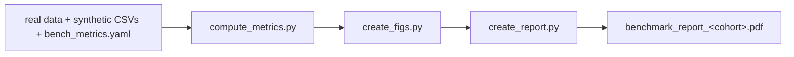

# rna-twin

Synthetic bulk RNA-seq cohorts made with dbTwin, the real cohorts they came from, and the
benchmark we use to check them.

[](https://www.python.org/)
[](LICENSE)
[](hf/LICENSE)
<!-- TODO: link the companion preprint DOI once it is assigned. -->

[](https://huggingface.co/datasets/NandaAditya/rna-twin)

Matching expression distributions don't tell you whether a synthetic cohort gives the same
answers as the real one. So we test the answers directly. For three public cohorts (pediatric
IBD, sepsis, and lung adenocarcinoma), we compare synthetic and real data on co-expression,
differential expression, classifiers scored on held-out real patients, and SHAP gene
importance. We also run two empirical privacy attacks. Each cohort gets a PDF report.

This repository has the code, the real data, and the saved results. The synthetic CSVs are
on [Hugging Face](https://huggingface.co/datasets/NandaAditya/rna-twin), behind a short data
use agreement.


*Sepsis. (A) Real and synthetic samples in one UMAP fit. (B) Gene-gene correlations for the
500 most variable genes: real below the diagonal, synthetic above, same gene order.*

## Quick start

1. Install [uv](https://docs.astral.sh/uv/getting-started/installation/), then clone:

   ```sh
   git clone https://github.com/Nanda-Aditya/rna-twin.git
   cd rna-twin
   ```

2. On the [dataset page](https://huggingface.co/datasets/NandaAditya/rna-twin), log in, fill in
   the form, and click **Agree and access**.
3. Set up the environments and download the synthetic data, then run the benchmark for one
   cohort:

   ```sh
   uv run python get_data.py
   uv run python scripts/run_pipe.py sepsis
   ```

   `get_data.py` asks you to log in to Hugging Face. Use the account from step 2.

`run_pipe.py` recomputes every metric from the real and synthetic CSVs, which takes 1–2 hours
per cohort. To rebuild only the figures and the PDF from the saved metrics (under a minute),
add `--no-full-compute`.

The report is written to `datasets/sepsis/dbTwin/benchmark_report_sepsis.pdf`. Figures are in
`artifacts/figs/` and summary metrics in `artifacts/metrics.csv`.

## Results

These numbers come from the reports in this repository (generated November 2–3, 2026).
Values with ± are mean ± SD over five outer splits. Co-expression, UMAP, and DE compare the
full synthetic cohort with the full real cohort once. ✅ marks a pass against the report's
fixed thresholds (see [How we evaluate](#how-we-evaluate)).

| | Pass if | [Pediatric RISK](datasets/pediatric_risk/dbTwin/benchmark_report_pediatric_risk.pdf) | [Sepsis](datasets/sepsis/dbTwin/benchmark_report_sepsis.pdf) | [TCGA-LUAD](datasets/tcga_luad/dbTwin/benchmark_report_tcga_luad.pdf) |
|---|---|---:|---:|---:|
| Co-expression Spearman ρ | ≥ 0.8 | 0.996 ✅ | 0.965 ✅ | 0.940 ✅ |
| UMAP MMD | ≤ 0.1 | 0.022 ✅ | 0.037 ✅ | 0.020 ✅ |
| TRTR ROC-AUC (real reference) | | 0.880 ± 0.032 | 0.894 ± 0.032 | 0.573 ± 0.036 |
| TSTR ROC-AUC | ≥ TRTR − 0.05 | 0.878 ± 0.035 ✅ | 0.893 ± 0.027 ✅ | 0.573 ± 0.044 ✅ |
| SHAP Pearson r | ≥ 0.8 | 0.949 ± 0.012 ✅ | 0.881 ± 0.043 ✅ | 0.828 ± 0.056 ✅ |


**Differential expression.** Recall is the share of real DE genes that are also significant
in the synthetic cohort at the relaxed threshold. Slope is synthetic on real log2FC; below 1
means synthetic effects are shrunk.

| Cohort | Contrast | Real DE genes | log2FC r (≥ 0.8) | Slope | Recall (≥ 80%) |
|---|---|---:|---:|---:|---:|
| Pediatric RISK | Crohn's disease vs control | 5,641 | 0.993 ✅ | 1.00 | 96% ✅ |
| Pediatric RISK | Ulcerative colitis vs control | 1,169 | 0.980 ✅ | 0.95 | 82% ✅ |
| Sepsis | SepsisBSI vs No-Sepsis | 2,743 | 0.994 ✅ | 1.01 | 97% ✅ |
| TCGA-LUAD | KRAS, 0 vs 1 | 1,121 | 0.961 ✅ | 0.94 | 92% ✅ |
| TCGA-LUAD | EGFR, 0 vs 1 | 1,369 | 0.970 ✅ | 0.92 | 93% ✅ |
| TCGA-LUAD | STK11, 0 vs 1 (not an anchor, not graded) | 2,586 | 0.883 | 0.70 | 69% |

STK11 is the useful counterexample. It wasn't an anchor variable. The effect sizes still
correlate (r = 0.88), but recall drops to 69% and effects shrink by about 30%.

**Privacy.**

| | Pediatric RISK | Sepsis | TCGA-LUAD |
|---|---:|---:|---:|
| DCR 5th-percentile ratio | 0.916 ± 0.011 | 1.056 ± 0.035 | 1.047 ± 0.012 |
| Attribute inference excess, clinical QIs | 0.029 | 0.066 | 0.028 |
| Attribute inference excess, QIs + 100 genes | 0.094 | 0.112 | 0.143 |
| Secrets with excess > 0.2 (clinical / + genes) | 0 / 1 | 0 / 0 | 0 / 3 |

A DCR ratio near 1 means synthetic records are no closer to training patients than training
patients are to each other. Excess success is the attack's success rate on training patients
minus its rate on held-out patients. Each row reports the median of the 10 highest per-secret
means. Neither test is a privacy guarantee.

## The cohorts

| Folder | Source | Samples | Genes | Clinical columns | Prediction target | Anchors |
|---|---|---:|---:|---:|---|---|
| `pediatric_risk` | RISK pediatric IBD, [GSE57945](https://www.ncbi.nlm.nih.gov/geo/query/acc.cgi?acc=GSE57945) | 322 | 43,790 | 4 | `sample_disease`: Crohn's, UC, control | disease, age, sex |
| `sepsis` | [GSE184900](https://www.ncbi.nlm.nih.gov/geo/query/acc.cgi?acc=GSE184900) | 152 | 27,097 | 4 | `Classification`: SepsisBSI vs No-Sepsis | classification, age, sex |
| `tcga_luad` | TCGA-LUAD, [cBioPortal PanCancer Atlas](https://www.cbioportal.org/study/summary?id=luad_tcga_pan_can_atlas_2018) | 510 | 19,719 | 10 | `clinical_stage_clean`: I, II, advanced | EGFR, KRAS, stage, age, sex |

dbTwin takes an expression count matrix, sample metadata, and optional anchor columns. Anchors
are the clinical or biological variables you most want preserved. dbTwin supports 7-10 anchors,
and these cohorts use 3-5. We grade only anchored endpoints.

Each cohort has one full synthetic dataset, the same size and columns as the real cohort. It
also has five training-fold datasets, each generated from one real training split only. Use
the full file for the clinical, co-expression, UMAP, and DE comparisons. Use each fold file
against its matching held-out real split for TSTR, SHAP, and privacy. Splits 0–4 in
`real_data/split_manifest.csv` correspond to fold files 1–5.

> [!NOTE]
> Don't pool the five fold files into one cohort. Each is a separate synthetic version of a
> different training split.

The first CSV column is the sample index. Gene columns keep their source IDs: Ensembl IDs, plus
some gene symbols in TCGA-LUAD. The RISK and sepsis values are integer read counts. TCGA-LUAD
values are upper-quartile-normalized RSEM estimates, not read counts: each sample's 75th
percentile of non-zero genes is about 1,000, and the synthetic values are integers on that same
scale. Each cohort folder has a `README.md` with the exact source files, processing steps,
and clinical column codings.

## How we evaluate

All expression analyses use log2(CPM + 1), with CPM computed from each sample's total counts.

| Check | Method | Pass if |
|---|---|---|
| Clinical fidelity | Total variation distance (TVD) between real and synthetic anchor distributions within each target class, compared with a 500-resample bootstrap band for sampling noise | not graded |
| Co-expression | Pearson gene-gene correlations for the 500 most variable real genes; Spearman ρ between the real and synthetic upper triangles | ρ ≥ 0.8 |
| Global structure | Genes above the 40th variance percentile, 100 joint principal components, one 2-D UMAP fit, then RBF-kernel MMD on the UMAP coordinates | MMD ≤ 0.1 |
| Differential expression | DESeq2 fit separately to real and synthetic counts. Real DE genes: padj < 0.05 and \|log2FC\| > 0.5. Synthetic DE genes: strict (padj < 0.05, \|log2FC\| > 0.5) or relaxed (padj < 0.075, \|log2FC\| > 0.4). r and slope use all real DE genes; recall uses the relaxed set. All genes are tested in every cohort, but the summaries count only the 80% of tested genes with the highest mean real CPM. DESeq2 gets values rounded to integers. DESeq2 assumes raw counts, so the TCGA-LUAD p-values compare real and synthetic like for like but aren't calibrated tests. | r ≥ 0.8 and recall ≥ 80% |
| Prediction | Elastic-net logistic regression over five stratified outer splits, using the most variable genes (90% of the training-fold size). C is tuned on real training data only and reused for both models. TRTR and TSTR are scored on the same held-out real patients. | TSTR ≥ TRTR − 0.05 |
| SHAP | Mean \|SHAP\| on held-out real patients for the top 50 genes of the real-trained model, compared between real- and synthetic-trained models per class | r ≥ 0.8 |
| DCR | 5th percentile of synthetic-to-nearest-training distance divided by the 5th percentile of training-to-nearest-other-training distance, on standardized expression | reported only |
| Attribute inference | Anonymeter. The attacker knows the clinical QIs (age, sex), with or without 100 expression genes, and guesses the other clinical variables and 100 gene secrets. | reported only |

The thresholds are a fixed bar we use across cohorts, not a universal standard. The reports
have the full methods, per-class SHAP tables, clinical plots, and DE counts.

## Running the benchmark

```sh
uv run python scripts/run_pipe.py pediatric_risk               # or sepsis, tcga_luad
uv run python scripts/run_pipe.py                              # all three
uv run python scripts/run_pipe.py sepsis --no-full-compute     # figures + PDF only
```



By default the runner recomputes everything: DESeq2, UMAP, the classifiers, and the privacy
attacks. That takes 1–2 hours per cohort and overwrites the saved outputs. With
`--no-full-compute` it reuses the saved metrics and only rebuilds the figures and the PDF, in
under a minute.

Per-cohort settings are in `datasets/<cohort>/dbTwin/bench_metrics.yaml`: the prediction target,
DE contrasts, anchors, attacker QIs, and gene counts. Changing them doesn't regenerate the
synthetic data, so run the full benchmark after any change. The regularization search
(`cv_results.csv`) is committed. To redo it, for example for sepsis:

```sh
uv run python scripts/cv_trn.py datasets/sepsis/real_data datasets/sepsis/dbTwin/artifacts --ml-target Classification --force
```

<details>
<summary><b>What get_data.py does</b></summary>

- `uv run` builds `.venv` from `uv.lock` with Python 3.12 (pinned in `.python-version`).
- Builds a separate `.venv_anonymeter` from `requirements_anon.txt`. Anonymeter 1.1.0 needs
  NumPy 1.x, and the benchmark finds that environment on its own.
- Logs in to Hugging Face. If you haven't accepted the agreement yet, it opens the dataset page
  and waits.
- Downloads any missing synthetic CSVs (18 files, about 438 MB) from the `v1.0.0` snapshot.
  HF `<cohort>/syn_<cohort>.csv` goes to `datasets/<cohort>/dbTwin/`, and HF
  `<cohort>/artifacts/syn_<cohort>_fold_<k>.csv` goes to `datasets/<cohort>/dbTwin/artifacts/`.
  Existing files are kept, so rerunning it resumes an interrupted download.

PDFs compile through the `typst` Python package, so there's nothing else to install.

</details>

<details>
<summary><b>Repository layout</b></summary>

```text
rna-twin/
|-- get_data.py               # Anonymeter environment + synthetic data download
|-- pyproject.toml, uv.lock   # main environment
|-- requirements_anon.txt     # Anonymeter environment
|-- hf/                       # HF dataset card, data license, data use agreement
|-- scripts/                  # pipeline entry points, Typst report template
|-- bench_utils/              # shared metric, plotting, and config code
`-- datasets/<cohort>/
    |-- README.md                     # source, processing, clinical codings
    |-- real_data/
    |   |-- expression.csv.gz         # samples x genes (normalized RSEM in TCGA-LUAD, else counts)
    |   |-- metadata.csv              # clinical variables
    |   `-- split_manifest.csv        # train/test assignments, splits 0-4
    `-- dbTwin/
        |-- syn_<cohort>.csv          # full synthetic cohort (from HF)
        |-- bench_metrics.yaml        # cohort settings
        |-- benchmark_report_<cohort>.pdf
        `-- artifacts/
            |-- syn_<cohort>_fold_<1-5>.csv   # synthetic training folds (from HF)
            |-- metrics.csv, dcr.csv, attribute_inference.csv
            |-- clinical_fidelity_metrics.csv, clinical_fidelity_data.csv
            |-- cv_results.csv                # regularization search
            |-- benchmark_artifacts.npz       # arrays for figures and reports
            |-- report_data.json, figure_metadata.json, data_files.json
            |-- generation_seeds.json
            |-- de/                           # per-contrast DE tables
            `-- figs/
```

| Script | What it does |
|---|---|
| [`scripts/run_pipe.py`](scripts/run_pipe.py) | Runs metrics, figures, and the report for one or all cohorts |
| [`scripts/compute_metrics.py`](scripts/compute_metrics.py) | Full-cohort and per-split fidelity, utility, and privacy metrics |
| [`scripts/create_figs.py`](scripts/create_figs.py) | Figures from saved artifacts |
| [`scripts/create_report.py`](scripts/create_report.py) | Report data and the Typst PDF |
| [`scripts/cv_trn.py`](scripts/cv_trn.py) | Regularization search on real training folds |
| [`scripts/setup_anonymeter.py`](scripts/setup_anonymeter.py) | Rebuilds only the Anonymeter environment |

Synthetic CSVs and local generator files (`real_data/*.npz`, `real_data/gen_config.yaml`) are
git-ignored.

</details>

<details>
<summary><b>Troubleshooting</b></summary>

| Problem | Fix |
|---|---|
| `uv` not found | Install uv and reopen the terminal |
| HF says access denied | Accept the agreement on the dataset page with the same account you logged in with. `uv run hf auth login --force` switches accounts. |
| `get_data.py` was interrupted | Run it again. It keeps finished files and fetches the rest. |
| `cv_results.csv` is missing | Run the `cv_trn.py` command above for that cohort |
| Saved gene counts don't match the config | Restore the config, or run without `--no-full-compute` |
| Anonymeter not found | `uv run python scripts/setup_anonymeter.py` |

Once the environments and data are in place, everything runs offline. Gene symbols come from
a packaged HGNC table; unmapped Ensembl IDs are shown as they are. `get_data.py` never overwrites
synthetic CSVs that are already there. If you switch to a different HF revision, replace the
files yourself and keep them consistent with the split manifest and the saved metrics.

</details>

## License, data sources, and citation

The code is Apache 2.0 ([LICENSE](LICENSE), [NOTICE](NOTICE)). The synthetic data is © 2026
dbTwin, Inc. and licensed under CC BY-NC 4.0 ([hf/LICENSE](hf/LICENSE)). To download it, you
accept a short [data use agreement](hf/DUA.md): noncommercial use only, and no reconstructing
dbTwin's generation method or training a model to imitate it. Benchmarking, comparing
generators, privacy testing, and publishing your results are all allowed. For commercial
licensing, email aditya@dbtwin.ai.

The real data comes from GEO ([GSE57945](https://www.ncbi.nlm.nih.gov/geo/query/acc.cgi?acc=GSE57945)
via Expression Atlas, [GSE184900](https://www.ncbi.nlm.nih.gov/geo/query/acc.cgi?acc=GSE184900))
and TCGA ([cBioPortal PanCancer Atlas](https://www.cbioportal.org/study/summary?id=luad_tcga_pan_can_atlas_2018)).
Its original terms apply, so please cite the original studies listed in each cohort's
`README.md`. The TCGA results shown here are in whole or part based upon data generated by the
TCGA Research Network: https://www.cancer.gov/tcga.

If you use the benchmark or the data, please cite this repository:

```bibtex
@software{nanda2026rnatwin,
  title  = {rna-twin: synthetic bulk RNA-seq cohorts and benchmark},
  author = {Nanda, Aditya and Saha, Somdutta},
  year   = {2026},
  url    = {https://github.com/Nanda-Aditya/rna-twin}
}
```

Questions or bugs: open an issue or email aditya@dbtwin.ai.
